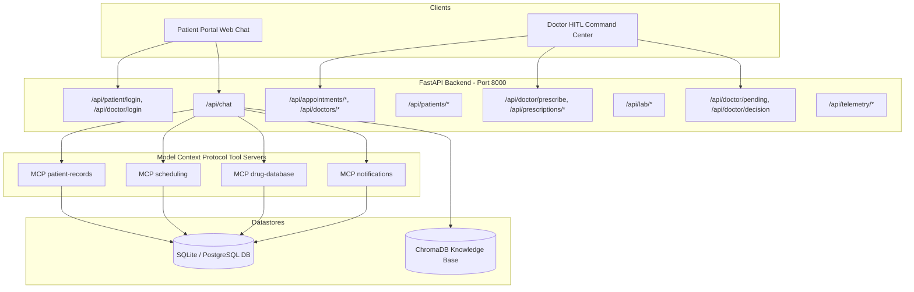
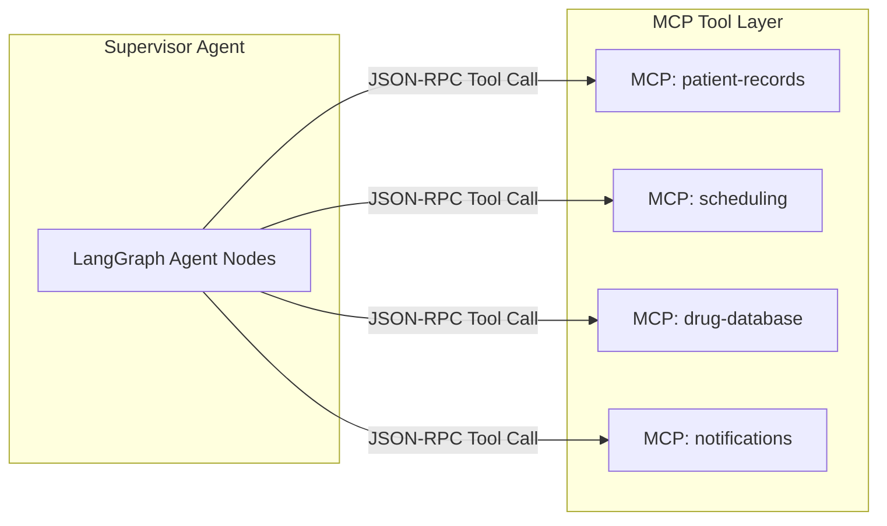

# API and Model Context Protocol (MCP) Server Documentation

This document provides technical reference documentation for the City Care Clinics backend application programming interfaces (FastAPI) and the decoupled Model Context Protocol (MCP) tool servers.

---

## 1. Architecture Overview

The backend is built around two communication layers:
1. **RESTful HTTP API Layer**: Built on FastAPI, serving client requests from the Patient Web Chat, Receptionist Console, and Doctor HITL Command Center.
2. **Model Context Protocol (MCP) Layer**: Standardized tool servers exposing EHR access, doctor scheduling, drug monographs, and notification dispatch to LangGraph agent nodes.



---

## 2. FastAPI Endpoint Reference

The backend operates by default on `http://127.0.0.1:8000`.

### Health Check

#### Endpoint: GET /api/health
* **Description**: Verifies server responsiveness, LangGraph readiness, and branch configuration.
* **Headers**: None
* **Sample Response (200 OK)**:
```json
{
  "status": "healthy",
  "system": "City Care Clinics Multi-Agent Orchestration",
  "model": "gemini-3.5-flash-lite",
  "langgraph_ready": true,
  "branches": [
    "Gulberg Lahore",
    "DHA Lahore",
    "Johar Town Lahore",
    "F-8 Islamabad",
    "Blue Area Islamabad"
  ],
  "timestamp": "2026-10-12T05:15:00.000000+00:00"
}
```

---

### Authentication and Patient Registration

#### Endpoint: POST /api/patient/login
* **Description**: Authenticates a patient using email, phone number, or MRN with salted SHA-256 verification.
* **Request Body**:
```json
{
  "identifier": "ahmed.khan@example.com",
  "password": "Patient123!"
}
```
* **Sample Response (200 OK)**:
```json
{
  "success": true,
  "token": "ptok_p1_1760245000",
  "patient": {
    "patient_id": "p1",
    "patient_name": "Ahmed Khan",
    "email": "ahmed.khan@example.com",
    "phone": "0300-1234567",
    "mrn": "MRN-LHR-1001",
    "gender": "Male",
    "age": 42,
    "known_allergies": ["Penicillin"],
    "chronic_conditions": ["Hypertension"],
    "preferred_doctor": "Dr. Bilal Saeed",
    "preferred_branch": "Gulberg Lahore",
    "preferred_language": "UrduLish"
  }
}
```

#### Endpoint: POST /api/patients/signup
* **Description**: Registers a new patient, calculates MRN, salts and hashes the password, and provisions clinical memory.
* **Request Body**:
```json
{
  "patient_name": "Zainab Bibi",
  "email": "zainab.bibi@example.com",
  "phone": "0321-9876543",
  "password": "SecurePassword123!",
  "age": 28,
  "gender": "Female",
  "known_allergies": ["Sulfa Drugs"],
  "chronic_conditions": ["Asthma"],
  "preferred_language": "UrduLish",
  "preferred_branch": "DHA Lahore"
}
```
* **Sample Response (200 OK)**:
```json
{
  "success": true,
  "message": "Patient Zainab Bibi registered successfully with MRN MRN-LHR-1031! Password securely protected in database.",
  "token": "ptok_p1031_1760245100",
  "patient": {
    "patient_id": "p1031",
    "patient_name": "Zainab Bibi",
    "mrn": "MRN-LHR-1031"
  }
}
```

#### Endpoint: POST /api/doctor/login
* **Description**: Authenticates physician credentials for the HITL Command Center.
* **Request Body**:
```json
{
  "email": "dr.bilal.saeed@citycare.com",
  "password": "Doctor123!"
}
```
* **Sample Response (200 OK)**:
```json
{
  "success": true,
  "token": "token_doc_1_1760245200",
  "doctor": {
    "doctor_id": "doc_1",
    "name": "Dr. Bilal Saeed",
    "specialty": "General Medicine",
    "branch": "Gulberg Lahore",
    "role": "Senior Consultant",
    "pmdc_number": "PMDC-22280-P"
  }
}
```

---

### Conversational Chat and Orchestration

#### Endpoint: POST /api/chat
* **Description**: Primary conversational interface. Executes turn through LangGraph with state persistence and telemetry tracking.
* **Request Body**:
```json
{
  "session_id": "sess_9182a",
  "message": "Mujhe pichle do din se bukhar aur gale mein shadeed dard hai",
  "patient_identifier": "MRN-LHR-1001",
  "is_returning_patient": true,
  "language": "Urdu"
}
```
* **Sample Response (200 OK)**:
```json
{
  "session_id": "sess_9182a",
  "reply": "Assalam-o-Alaikum Ahmed sahib! Aap ke bukhar ki shiddat kitni hai aur kya gale mein khansi ya nigalne mein takleef bhi hai?",
  "current_agent": "intake",
  "intake_form": {
    "chief_complaint": "Fever and sore throat",
    "duration": "2 days"
  },
  "triage_result": null,
  "hitl_required": false,
  "latency_ms": 78.4
}
```

---

### Scheduling and Directory Services

#### Endpoint: GET /api/doctors
* **Description**: Retrieves clinical staff roster with specialty, branch, fee, and availability filters.
* **Query Parameters**:
  * `specialty` (optional): Filter by medical specialty (e.g., General Medicine, Paediatrics).
  * `search` (optional): Full-text name or credential filter.
* **Sample Response (200 OK)**:
```json
{
  "doctors": [
    {
      "id": "doc_1",
      "pmdc_number": "PMDC-22280-P",
      "full_name": "Dr. Bilal Saeed",
      "specialty": "General Medicine",
      "qualification": "MBBS, FCPS (Internal Medicine)",
      "experience_years": 14,
      "consultation_fee": 2000,
      "branch_name": "Gulberg Lahore"
    }
  ],
  "count": 1
}
```

#### Endpoint: GET /api/doctors/{doctor_id}/schedule
* **Description**: Returns 20-minute consultation slots, booked appointments, and alternative slots if full.
* **Query Parameters**:
  * `date` (optional): Target date in `YYYY-MM-DD` format.
* **Sample Response (200 OK)**:
```json
{
  "doctor_id": "doc_1",
  "doctor_name": "Dr. Bilal Saeed",
  "date": "2026-10-12",
  "available_slots": [
    {"slot_start": "2026-10-12 17:00", "slot_end": "2026-10-12 17:20", "display": "05:00 PM"},
    {"slot_start": "2026-10-12 17:20", "slot_end": "2026-10-12 17:40", "display": "05:20 PM"}
  ],
  "is_fully_booked": false,
  "suggested_alternatives": []
}
```

#### Endpoint: POST /api/appointments/book
* **Description**: Confirms an outpatient consultation, preventing double-booking and sending email notifications.
* **Request Body**:
```json
{
  "patient_id": "p1",
  "doctor_id": "doc_1",
  "branch_id": "b1",
  "slot_iso": "2026-10-12T17:20:00Z",
  "reason": "Persistent fever and pharyngitis",
  "urgency": "ROUTINE",
  "patient_name": "Ahmed Khan",
  "patient_email": "ahmed.khan@example.com"
}
```
* **Sample Response (200 OK)**:
```json
{
  "success": true,
  "appointment_id": "apt_3019",
  "booking_reference": "CCC-BK-882190",
  "doctor_name": "Dr. Bilal Saeed",
  "specialty": "General Medicine",
  "fee": 2000,
  "google_calendar_url": "https://calendar.google.com/calendar/render?action=TEMPLATE&text=Consultation..."
}
```

---

### Prescriptions and Doctor HITL Command Center

#### Endpoint: GET /api/doctor/pending
* **Description**: Returns review tasks paused at the Human-in-the-Loop verification gate.
* **Sample Response (200 OK)**:
```json
{
  "pending_tasks": [
    {
      "task_id": "hitl_task_812",
      "task_type": "prescription_review",
      "patient_name": "Usman Tariq",
      "reason": "Proposed Augmentin for patient with Amoxicillin allergy",
      "draft_payload": {
        "drug": "Augmentin 625mg",
        "allergy_conflict": "Penicillin cross-sensitivity"
      },
      "created_at": "2026-10-12T05:00:00Z"
    }
  ],
  "count": 1
}
```

#### Endpoint: POST /api/doctor/decision
* **Description**: Processes physician determination (approve, edit, reject) and resumes LangGraph workflow.
* **Request Body**:
```json
{
  "task_id": "hitl_task_812",
  "decision": "edited",
  "edited_message": "Prescription changed from Augmentin to Azithromycin 500mg due to reported penicillin allergy.",
  "doctor_notes": "Approved alternative macrolide antibiotic."
}
```
* **Sample Response (200 OK)**:
```json
{
  "success": true,
  "task": {"task_id": "hitl_task_812", "status": "resolved"},
  "resumed_reply": "Doctor ne aap ki prescription review kar ke Azithromycin 500mg approve kar di hai."
}
```

#### Endpoint: POST /api/doctor/prescribe
* **Description**: Issues an official clinic prescription and marks the appointment as fulfilled.
* **Request Body**:
```json
{
  "appointment_id": "CCC-BK-882190",
  "diagnosis": "Acute Streptococcal Pharyngitis",
  "medicines": [
    {
      "drug_name": "Augmentin 625mg",
      "dosage": "625mg",
      "frequency": "Twice daily",
      "duration": "5 days",
      "instructions": "Take after meals"
    },
    {
      "drug_name": "Panadol 500mg",
      "dosage": "500mg",
      "frequency": "Three times daily as needed",
      "duration": "3 days",
      "instructions": "Take for fever and throat pain"
    }
  ],
  "advice": "Gargle with warm salt water thrice daily. Complete antibiotic course.",
  "doctor_name": "Dr. Bilal Saeed",
  "pmdc_number": "PMDC-22280-P"
}
```
* **Sample Response (200 OK)**:
```json
{
  "success": true,
  "message": "Prescription successfully issued for appointment CCC-BK-882190. Status updated to fulfilled.",
  "booking_reference": "CCC-BK-882190",
  "status": "fulfilled"
}
```

#### Endpoint: GET /api/prescriptions/{booking_ref}/pdf
* **Description**: Generates an official hospital-grade PDF prescription with PMDC registration, clinic header, and Rx schedule.
* **Response**: Binary stream (`application/pdf`) with `Content-Disposition: inline`.

---

### Multimodal Lab Vision Endpoints

#### Endpoint: POST /api/lab/upload
* **Description**: Ingests PDF or image lab reports, sanitizes prompt injection payloads, extracts numerical test parameters, flags out-of-range values, and creates an UrduLish explanation.
* **Form-Data**: `file` (Multipart file: PDF, PNG, JPG).
* **Sample Response (200 OK)**:
```json
{
  "success": true,
  "filename": "cbc_report_tariq.pdf",
  "processing_time_sec": 0.482,
  "data": {
    "patient_name": "Muhammad Tariq",
    "test_panel": "Complete Blood Count (CBC)",
    "parameters": [
      {
        "parameter": "Hemoglobin",
        "value": 14.2,
        "unit": "g/dL",
        "reference_range": "13.0 - 17.0",
        "status": "NORMAL"
      },
      {
        "parameter": "Platelets",
        "value": 92000,
        "unit": "/mcL",
        "reference_range": "150000 - 450000",
        "status": "LOW"
      }
    ],
    "abnormal_count": 1,
    "urdulish_summary": "Aap ke test mein Platelets normal se kam hain. Doctor se mashwara zaroori hai."
  }
}
```

---

## 3. Model Context Protocol (MCP) Server Specifications

City Care Clinics deploys four decoupled Model Context Protocol (MCP) servers.



---

### MCP Server 1: patient-records

* **Server Identifier**: `patient-records`
* **File Location**: `Day 2/mcp_servers/mcp_patient_records.py`
* **Purpose**: Manages access to patient demographic profiles, allergies, active medications, visit encounters, and lab observations.

#### Tool: `get_patient_profile(identifier: str)`
* **Description**: Retrieves demographic and clinical baseline data by phone number or MRN.
* **Input Schema**:
  * `identifier` (string, required): Patient phone number (e.g., `"0300-1234567"`) or MRN (e.g., `"MRN-LHR-1001"`).
* **Output Schema**:
  ```json
  {
    "found": true,
    "patient_id": "p1",
    "mrn": "MRN-LHR-1001",
    "full_name": "Ahmed Khan",
    "gender": "Male",
    "date_of_birth": "1984-06-12",
    "city": "Lahore",
    "known_allergies": ["Penicillin"],
    "chronic_conditions": ["Hypertension"],
    "current_medications": ["Lipiget 20mg", "Concor 5mg"]
  }
  ```

#### Tool: `get_patient_allergies(patient_id: str)`
* **Description**: Returns verified drug and environmental allergies.
* **Input Schema**: `patient_id` (string).
* **Output Schema**: `["Penicillin", "Dust Mites"]`

#### Tool: `get_patient_medications(patient_id: str)`
* **Description**: Returns active prescriptions and medication history.
* **Output Schema**:
  ```json
  [
    {
      "drug_name": "Concor 5mg",
      "generic_name": "Bisoprolol",
      "dosage_mg": 5.0,
      "frequency_per_day": 1,
      "duration_days": 30,
      "safety_check_status": "SAFE"
    }
  ]
  ```

#### Tool: `get_patient_history(patient_id: str, limit: int = 5)`
* **Description**: Retrieves past clinical visit encounters with SOAP assessments.

#### Tool: `get_patient_lab_results(patient_id: str, test_code: Optional[str] = None)`
* **Description**: Retrieves chronological laboratory test results and normal/abnormal flags.

---

### MCP Server 2: scheduling

* **Server Identifier**: `scheduling`
* **File Location**: `Day 2/mcp_servers/mcp_scheduling.py`
* **Purpose**: Handles doctor lookup, slot availability checks, booking confirmations, rescheduling, and cancellations across all five clinic branches.

#### Tool: `find_doctor(specialty: Optional[str] = None, branch_id: Optional[str] = None)`
* **Description**: Searches active doctors filtered by specialty and clinic branch.
* **Input Parameters**:
  * `specialty` (string, optional): One of General Medicine, Paediatrics, Gynaecology, Cardiology, Dermatology, ENT.
  * `branch_id` (string, optional): Branch identifier (`b1` to `b5`).
* **Output Schema**:
  ```json
  [
    {
      "doctor_id": "doc_1",
      "full_name": "Dr. Bilal Saeed",
      "specialty": "General Medicine",
      "qualification": "MBBS, FCPS",
      "experience_years": 14,
      "consultation_fee": 2000,
      "languages": ["Urdu", "English", "Punjabi"],
      "branch_id": "b1"
    }
  ]
  ```

#### Tool: `check_available_slots(doctor_id: str, target_date: str)`
* **Description**: Returns available 20-minute consultation slots on a given date (`YYYY-MM-DD`).

#### Tool: `book_appointment(patient_id: str, doctor_id: str, branch_id: str, slot_timestamp: str, reason: str, urgency: str = "ROUTINE")`
* **Description**: Creates a confirmed booking and writes an immutable audit record.
* **Output Schema**:
  ```json
  {
    "success": true,
    "appointment_id": "apt_9921",
    "booking_reference": "BK-2026-F9812A",
    "patient_name": "Ahmed Khan",
    "doctor_name": "Dr. Bilal Saeed",
    "specialty": "General Medicine",
    "fee_pkr": 2000,
    "scheduled_start": "2026-10-12T17:20:00Z",
    "status": "booked"
  }
  ```

#### Tool: `reschedule_appointment(appointment_id: str, new_slot_timestamp: str)`
* **Description**: Modifies the appointment time slot.

#### Tool: `cancel_appointment(appointment_id: str, reason: str)`
* **Description**: Cancels a booked appointment with a documented reason.

---

### MCP Server 3: drug-database

* **Server Identifier**: `drug-database`
* **File Location**: `Day 2/mcp_servers/mcp_drug_database.py`
* **Purpose**: Provides pharmaceutical monograph queries, pairwise drug interaction checks, dosage ceiling validations, and allergy screening.

#### Tool: `lookup_drug(query: str)`
* **Description**: Retrieves pharmaceutical details by Pakistani brand or generic name (e.g., Panadol, Augmentin, Lipiget, Brufen).
* **Output Schema**:
  ```json
  {
    "found": true,
    "brand_name": "Augmentin",
    "generic_name": "Amoxicillin + Clavulanic Acid",
    "drug_class": "Penicillin Antibiotic",
    "common_dosage_mg": 625.0,
    "max_daily_dose_mg": 2000.0,
    "pregnancy_category": "B",
    "contraindications": ["Penicillin Hypersensitivity", "Cholestatic Jaundice"],
    "allergy_group": "penicillin"
  }
  ```

#### Tool: `check_drug_interactions(drugs: List[str])`
* **Description**: Checks for dangerous pairwise drug interactions among proposed medicines.
* **Input Schema**: `["Warfarin", "Brufen"]`
* **Output Schema**:
  ```json
  [
    {
      "drug_a": "Warfarin",
      "drug_b": "Brufen",
      "severity": "CRITICAL",
      "clinical_rationale": "NSAIDs increase anticoagulant effect of Warfarin, causing major gastrointestinal bleeding risk."
    }
  ]
  ```

#### Tool: `check_dosage_limit(drug_name: str, dose_mg: float, frequency_per_day: int, age: int = 30)`
* **Description**: Verifies if daily dosage exceeds 24-hour therapeutic limits (e.g., Paracetamol max 4,000 mg/day).

#### Tool: `evaluate_full_prescription(proposed_drugs: List[str], patient_allergies: List[str], age: int = 30, is_pregnant: bool = false)`
* **Description**: Runs comprehensive multi-rule evaluation across allergy clashes, drug-drug interactions, duplicate therapies, and special population alerts.

---

### MCP Server 4: notifications

* **Server Identifier**: `notifications`
* **File Location**: `Day 2/mcp_servers/mcp_notifications.py`
* **Purpose**: Handles messaging across WhatsApp, SMS, and Email.

#### Tool: `send_whatsapp_message(recipient_phone: str, message_body: str, template_type: str = "appointment_confirmation")`
* **Description**: Dispatches authenticated WhatsApp Cloud API notifications in UrduLish.
* **Output Schema**:
  ```json
  {
    "status": "delivered",
    "message_id": "wamid.81092a18b72",
    "recipient_phone": "0300-1234567",
    "channel": "WhatsApp Cloud API",
    "template": "appointment_confirmation",
    "timestamp": "2026-10-12T05:20:00Z"
  }
  ```

#### Tool: `send_sms_alert(recipient_phone: str, alert_text: str, urgency: str = "ROUTINE")`
* **Description**: Sends SMS alerts for emergency warnings and one-time verification codes.

#### Tool: `send_email_confirmation(recipient_email: str, subject: str, html_body: str)`
* **Description**: Sends appointment confirmations with Google Calendar integration and PDF prescription attachments.
