# Comprehensive User Guides: Patients, Receptionists, and Doctors

This document provides step-by-step operational manuals for the three key user groups of the City Care Clinics Multi-Agent Healthcare Assistant.

```mermaid
graph TD
    subgraph "Patient Workflow"
        P1[Open Patient Portal] --> P2[UrduLish Conversational Intake]
        P2 --> P3[Doctor & Slot Selection]
        P3 --> P4[Appointment Confirmation & Google Calendar]
        P4 --> P5[Lab Report Upload & PDF Prescription Download]
    end

    subgraph "Receptionist Workflow"
        R1[Front Desk Console] --> R2[Walk-in Patient Fast Registration]
        R2 --> R3[Cross-Branch Slot Booking across 5 Branches]
        R3 --> R4[Rescheduling & Cancellation Management]
        R4 --> R5[De-escalation of Confused or Dissatisfied Patients]
    end

    subgraph "Doctor HITL Workflow"
        D1[Doctor Command Center Login] --> D2[Review Pre-Visit SOAP Briefs]
        D2 --> D3[Process Pending Review Tasks: Approve / Edit / Reject]
        D3 --> D4[Issue Official PMDC Prescription with Drug Safety Engine]
        D4 --> D5[Download Signed Hospital-Grade PDF]
    end
```



---

## 1. Patient User Guide

The City Care Clinics Patient Portal allows patients to discuss their symptoms in natural UrduLish or English, find specialists, confirm appointments, review lab reports, and download doctor-issued prescriptions.

### Step 1: Accessing the Portal
* Navigate to the clinic web address in your browser: `http://localhost:3000`
* You can interact as a **Guest Patient** or click **Sign In** to log into your personal medical account.
* If you have visited before, enter your registered Phone Number, Email, or Medical Record Number (MRN) along with your password.

### Step 2: Describing Symptoms to the Assistant
* Type your health concerns in whatever language feels most natural (UrduLish, Roman Urdu, or English).
* The assistant greets you politely and asks questions one at a time to understand your condition:
  * What is your main complaint?
  * How many days have you had these symptoms?
  * How severe is the pain or discomfort on a scale of 1 to 10?
  * Do you have any known drug allergies?

#### Example Conversation
```text
Patient: "Assalam-o-Alaikum, mujhe teen din se bukhar aur shadeed gala kharab hai."
Assistant: "Walaikum Assalam! Aap ki takleef sun kar afsos hua. Yeh batayein ke bukhar kitna teez hai aur kya gala nigalne mein dard kar raha hai? Dard 1 se 10 mein kitna hai?"
Patient: "Bukhar 101 hai aur dard takreeban 6 hai."
Assistant: "Shukriya. Kya aap ko kisi dawai se allergy hai ya pehle se koi bemari jaisay diabetes ya BP hai?"
Patient: "Mujhe Penicillin se allergy hai."
```

### Step 3: Emergency Situations
* If you experience dangerous red-flag symptoms such as crushing chest pain, sudden facial numbness, or severe breathing difficulty, the assistant will stop routine booking immediately.
* It will display a red emergency warning banner instructing you to call **Rescue 1122** or go to the nearest emergency room.

### Step 4: Selecting a Doctor and Booking an Appointment
* The assistant analyzes your symptoms and recommends the correct clinical specialty (e.g., General Medicine, Paediatrics, Gynaecology, Cardiology, Dermatology, or ENT).
* Choose your preferred branch:
  1. Gulberg Lahore
  2. DHA Lahore
  3. Johar Town Lahore
  4. F-8 Islamabad
  5. Blue Area Islamabad
* The assistant presents available doctors and open 20-minute slots.
* Confirm your slot. You will receive a unique Booking Reference (e.g., `CCC-BK-882190`), a confirmation email, and a clickable link to add the event to your Google Calendar.

### Step 5: Uploading and Reviewing Lab Reports
* Click the **Upload Lab Report** button in the chat interface.
* Select your diagnostic report (PDF, PNG, or JPG) from your device.
* The system reads your test numbers (such as HbA1c, CBC, or Liver Function Tests), highlights any out-of-range parameters, and explains what they mean in plain, non-diagnostic UrduLish.
* **Important Note**: Lab results are explained for educational purposes only. Always consult your attending doctor for clinical diagnosis and treatment.

### Step 6: Downloading Official Prescriptions
* After your in-person consultation, your doctor issues an official digital prescription.
* Open your **Appointments** tab or click the prescription banner in chat.
* Click **Download Official Prescription PDF** to save or print the hospital-grade document featuring your doctor's PMDC registration number and medication timings.

---

## 2. Receptionist User Guide

Front-desk clinic receptionists use the Assistant Console to manage walk-in queues, register new patients, coordinate appointments across all five branches, and handle patient inquiries.

### Step 1: Rapid Walk-In Patient Registration
When an unregistered walk-in patient arrives at the front desk:
1. Open the **Patient Registration** tab.
2. Enter the patient's Full Name, Mobile Phone Number, Age, and Gender.
3. Record any critical medical notes:
   * Known drug allergies (e.g., Penicillin, Sulfa, Aspirin).
   * Chronic health conditions (e.g., Hypertension, Diabetes).
4. Click **Create Patient Record**. The system automatically generates a unique Medical Record Number (MRN) formatted by branch (e.g., `MRN-LHR-1045` or `MRN-ISB-2012`).

### Step 2: Multi-Branch Appointment Scheduling
If a patient calls or requests a booking in person:
1. Open the **Doctor Directory** tab.
2. Select the requested Specialty and Branch.
3. Review doctor schedules in real time:
   * Green indicates open 20-minute slots.
   * Red indicates booked slots.
4. If a preferred doctor is fully booked on the requested date, the console displays three alternative non-conflicting slots over the next seven days.
5. Click **Confirm Slot** to book. Provide the patient with their six-character Booking Reference code.

### Step 3: Rescheduling and Cancellations
1. Enter the patient's Booking Reference into the search bar.
2. To reschedule: Click **Reschedule**, select the new date and time, and click **Save**. The previous slot is immediately released for other patients.
3. To cancel: Click **Cancel Appointment**, select a cancellation reason from the dropdown (e.g., Patient Request, Physician Unavailable), and confirm.

### Step 4: Fee Structure and Consultation Pricing
* Standard consultation fees across specialties:
  * General Medicine: PKR 2,000
  * Paediatrics: PKR 2,200
  * Dermatology: PKR 2,500
  * ENT: PKR 2,500
  * Gynaecology: PKR 2,800
  * Cardiology: PKR 3,000
* Inform patients that consultation fees cover physical examination, vital signs check, pre-visit summary review, and digital prescription issuance.

### Step 5: Handling Confused or Dissatisfied Patients
If a patient is upset about wait times, fees, or technical issues:
1. Maintain a calm, respectful tone in Urdu.
2. Direct the patient to the Front Desk Manager for complex billing disputes.
3. If a patient feels unwell while waiting in the lobby, review their recorded symptoms. If red-flag symptoms are reported, transfer the patient immediately to the triage nurse or on-duty emergency medical officer.

---

## 3. Doctor User Guide

Physicians use the Doctor HITL Command Center to review patient histories, inspect pending AI review tasks, consult pre-visit SOAP briefs, and issue safe digital prescriptions.

### Step 1: Physician Authentication
1. Navigate to the Doctor Command Center: `http://localhost:3000/doctor-portal`
2. Enter your institutional email address (e.g., `dr.bilal.saeed@citycare.com`) and password.
3. The dashboard opens, showing your active clinic branch, verified PMDC number, today's consultation schedule, and pending review tasks.

### Step 2: Navigating the Pending Review Queue (HITL Gates)
The Human-in-the-Loop review queue pauses AI execution whenever clinical safety requires licensed medical oversight:
* **Review Gate Type 1: High-Risk Lab Explanations**
  * Triggered when a patient's uploaded lab report contains critical out-of-range values (e.g., Platelets under 50,000 /mcL or Creatinine over 3.0 mg/dL).
  * The doctor inspects the extracted parameters and the AI-generated patient explanation.
* **Review Gate Type 2: Medication Conflict Warnings**
  * Triggered when a patient asks about taking conflicting medications or requests medicines related to recorded allergies.
* **Review Gate Type 3: Low-Confidence Triage Decisions**
  * Triggered when symptom complexity results in a triage classification confidence score below 0.85.

#### Decision Actions
* **Approve**: Confirms the AI draft without changes and releases the response to the patient's chat session.
* **Edit**: Modifies the message text to provide tailored medical advice before sending.
* **Reject**: Blocks the response and replaces it with an urgent invitation for an in-person physical consultation.

### Step 3: Pre-Visit Clinical SOAP Briefs
Before the patient enters the examination room:
1. Click the patient's name on today's appointment list.
2. Click **View Pre-Visit SOAP Brief**.
3. The brief clearly separates patient-reported history from AI differential suggestions:
   * **Subjective**: Chief complaint, symptom duration, pain score, reported allergies, and past medical history.
   * **Objective**: Recent laboratory observations and abnormal flags.
   * **Assessment (AI Differential Suggestions)**: Algorithms provide possible clinical directions for physician consideration. These are clearly marked as suggestions, not diagnoses.
   * **Plan (Draft)**: Suggested investigations and management pathways.

### Step 4: Issuing Prescriptions with Safety Checks
During or after the consultation:
1. Open the **Issue Prescription** form for the active appointment.
2. Enter your clinical diagnosis (e.g., "Acute Streptococcal Pharyngitis").
3. Add prescribed medications:
   * Select brand name (e.g., Augmentin 625mg, Panadol 500mg, Lipiget 20mg).
   * Specify dosage, frequency, duration, and patient instructions.
4. As you type, the **Prescription Safety Engine** cross-checks every drug:
   * **Allergy Check**: Compares proposed drugs against the patient's allergy records.
   * **Drug-Drug Interactions**: Flags dangerous combinations (e.g., Warfarin + Brufen, ACE Inhibitor + Potassium).
   * **Maximum Daily Dose**: Verifies 24-hour safe limits.
   * **Special Populations**: Flags contraindications for pregnant patients or young children.
5. If a conflict is detected, a prominent warning banner appears detailing the clinical risk. You can modify the drug selection or proceed with documented justification.
6. Click **Sign and Issue Prescription**. The appointment status updates to fulfilled.

### Step 5: Official Prescription PDF Generation
* Once issued, click **View / Print Official Prescription**.
* The system produces a formatted PDF document containing:
  * City Care Clinics branding and branch contact details.
  * Patient Name, Age, Gender, and unique MRN.
  * Attending Physician Name, Qualification, Specialty, and PMDC License Number.
  * Formal Rx symbol, medication table with timings, duration, and food instructions.
  * Physician advice block and digital signature verification seal.
* Print a physical copy for the patient or send the digital PDF directly to their registered email address.

---

## 4. Summary of User Workflows

| User Role | Primary Interface | Key Actions | Key Safety Constraint |
| :--- | :--- | :--- | :--- |
| **Patient** | Web Chat Portal | Symptom chat, specialist discovery, booking, lab uploads, PDF downloads | Emergency red flags trigger immediate 1122 escalation |
| **Receptionist** | Front Desk Console | Patient registration, cross-branch scheduling, slot changes, fee queries | Cannot provide medical triage advice over the counter |
| **Doctor** | HITL Command Center | Review pending tasks, consult SOAP briefs, prescribe with safety checks | Must verify PMDC credentials before issuing official prescriptions |
