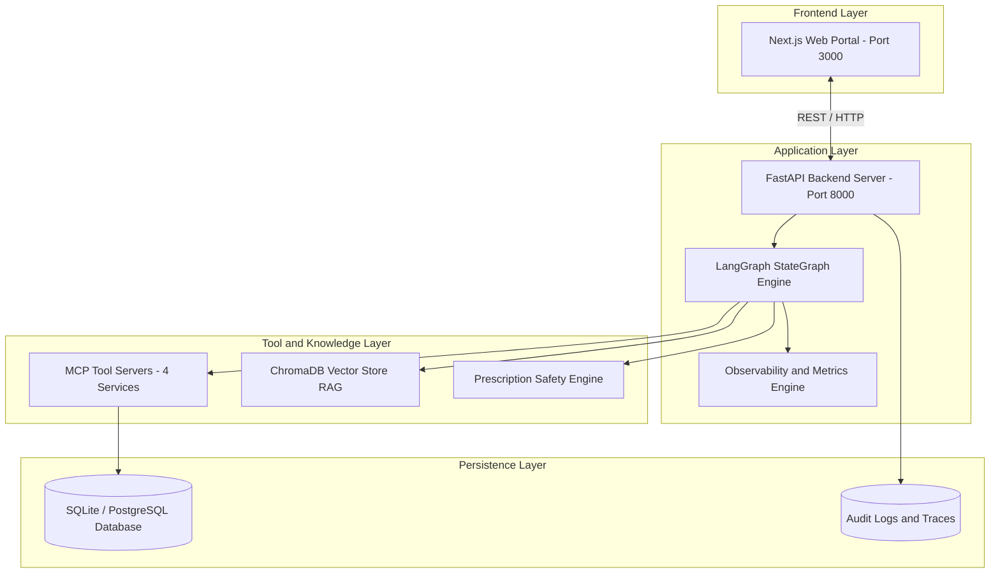
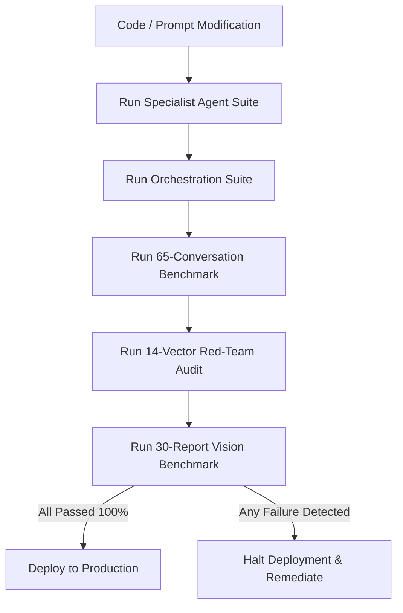

# System Maintenance and Operations Guide

This guide establishes the standard operating procedures, routine maintenance tasks, backup protocols, observability monitoring, and incident response runbooks for the City Care Clinics Multi-Agent Healthcare Assistant.

---

## 1. System Topology and Component Map

The production environment consists of five coupled components:



---

## 2. Daily Health Checks and Telemetry Monitoring

System administrators and devops engineers must verify service health through these standard checks:

### Health Check Endpoint
* **Endpoint**: `GET http://127.0.0.1:8000/api/health`
* **Command (PowerShell)**:
  ```powershell
  Invoke-RestMethod -Uri "http://127.0.0.1:8000/api/health" | Format-List
  ```
* **Expected Result**: Status returns `healthy` with `langgraph_ready: true` and all five clinic branches active.

### Operational KPIs and Alert Thresholds

| Operational Metric | Healthy Target | Warning Threshold | Critical Incident Threshold |
| :--- | :---: | :---: | :---: |
| **Average Turn Latency** | < 150 ms | > 1,000 ms | > 3,000 ms |
| **Gemini API Error Rate** | < 0.1% | > 2.0% | > 5.0% |
| **Cost Per Conversation** | < $0.0001 USD | > $0.005 USD | > $0.02 USD |
| **Emergency Detection Recall** | **100.0%** | < 100.0% | < 100.0% (Zero Tolerance) |
| **HITL Review Queue Backlog** | < 5 tasks | > 15 tasks | > 30 tasks |
| **Active Memory Cache Size** | < 50 MB | > 200 MB | > 500 MB (Suspected Leak) |

### Telemetry Inspection
* **Inspect Aggregated Statistics**:
  ```powershell
  Invoke-RestMethod -Uri "http://127.0.0.1:8000/api/telemetry/stats"
  ```
* **Inspect Recent Execution Traces**:
  ```powershell
  Invoke-RestMethod -Uri "http://127.0.0.1:8000/api/telemetry/traces"
  ```

---

## 3. Database Maintenance, Backups, and Recovery

The relational database houses appointments, patient profiles, doctors, encounters, and audit trails.

### Database File Locations
* **Active SQLite Database**: `Day 2/data/clinic.db`
* **Baseline Database Schema**: `Day 2/schema.sql`
* **Local Doctor Credentials Store**: `doctor_credentials.json`
* **Local Patient Test Accounts**: `patient_credentials.json`

### Automated Daily Backup Script
Execute daily rolling backups using PowerShell:

```powershell
# Create backups directory if missing
$backupDir = "Day 2/backups"
if (!(Test-Path $backupDir)) { New-Item -ItemType Directory -Path $backupDir }

# Format timestamp
$timestamp = Get-Date -Format "yyyyMMdd_HHmmss"
$targetBackup = "$backupDir/clinic_backup_$timestamp.db"

# Copy SQLite file with write-lock safety
Copy-Item -Path "Day 2/data/clinic.db" -Destination $targetBackup
Write-Host "Database backup created successfully: $targetBackup"

# Retention policy: Remove backups older than 30 days
Get-ChildItem -Path $backupDir -Filter "*.db" | Where-Object {
    $_.CreationTime -lt (Get-Date).AddDays(-30)
} | Remove-Item
```

### Database Restoration Procedure
In the event of accidental data corruption:
1. Stop the running FastAPI backend server:
   ```powershell
   Stop-Process -Name "python" -Force
   ```
2. Locate the most recent healthy backup file in `Day 2/backups/`.
3. Overwrite the active database file:
   ```powershell
   Copy-Item -Path "Day 2/backups/clinic_backup_20261012_050000.db" -Destination "Day 2/data/clinic.db" -Force
   ```
4. Verify database integrity:
   ```powershell
   python -c "import sqlite3; conn = sqlite3.connect('Day 2/data/clinic.db'); cur = conn.cursor(); cur.execute('PRAGMA integrity_check;'); print(cur.fetchone())"
   ```
   * Output must be `('ok',)`
5. Restart the backend server.

---

## 4. Knowledge Base and Vector Store RAG Maintenance

The RAG pipeline provides context on clinic operational policies and pharmaceutical guidance.

### Rebuilding the ChromaDB Vector Index
When updating clinic doctor rosters, consultation fees, or branch hours:
1. Edit documentation in `Day 2/knowledge_base/`.
2. Run the RAG pipeline rebuild command:
   ```powershell
   python "Day 2/rag_pipeline.py"
   ```
3. Evaluate semantic retrieval accuracy:
   ```powershell
   python "Day 2/evaluate_rag.py"
   ```
   * Target grounding rate must exceed 90.0% with zero hallucinations.

### Adding New Medications to the Safety Formulary
When the clinic pharmacy introduces a new medicine:
1. Open `Day 2/prescription_safety_engine.py`.
2. Append the new entry to the `DRUG_DATABASE` dictionary:
   ```python
   "claritek": {
       "brand_name": "Claritek",
       "generic_name": "Clarithromycin",
       "drug_class": "Macrolide Antibiotic",
       "common_dosage_mg": 500,
       "max_daily_dose_mg": 1000,
       "pregnancy_category": "C",
       "contraindications": ["Hypersensitivity", "Severe Hepatic Impairment", "QT Prolongation"],
       "allergy_group": "macrolides"
   }
   ```
3. Add any relevant drug-drug interaction pairs to `DRUG_INTERACTIONS`.
4. Validate the update by executing:
   ```powershell
   python "Day 2/test_prescription_safety.py"
   ```

---

## 5. Model Lifecycle and Pre-Deployment Regression Protocol

Before deploying new prompt templates, updating the LangChain framework, or switching LLM models:



### Pre-Deployment Verification Commands
Run each command sequentially. Every test must pass:

1. **Verify Specialist Agents**:
   ```powershell
   python "Day 3/test_all_agents.py"
   ```
2. **Verify Multi-Agent Orchestration and State Transitions**:
   ```powershell
   python "Day 4/test_day_4_orchestration.py"
   ```
3. **Execute Comprehensive 65-Conversation Clinical Suite**:
   ```powershell
   python "Day 5/evaluation_suite_60.py"
   ```
   * Verification Target: Task Success Rate > 95%, Emergency Recall = 100%.
4. **Execute Adversarial Red-Team Audit (14 Vectors)**:
   ```powershell
   python "Day 5/safety_red_teaming.py"
   ```
   * Verification Target: 14/14 Defended (100.0%), 0 Leaked Records.
5. **Execute Multimodal Lab Vision Parser (30 Benchmark Reports)**:
   ```powershell
   python "Day 5/evaluate_30_reports.py"
   ```
   * Verification Target: Parameter Recall > 98%, Zero Extraction Crashes.

---

## 6. Incident Response Runbooks

### Incident 1: LLM API Rate Limiting or Upstream Timeout
* **Symptoms**: Latency spikes above 3,000 ms, or log entries showing `ResourceExhausted (429)` from Google Gemini.
* **Immediate Response**:
  1. The system automatically activates exponential backoff retries (three attempts).
  2. If retries fail, `SupervisorAgent` serves structured fallback responses in UrduLish:
     *"Hum maazrat khwah hain, system is waqt masroof hai. Barah-e-karam chand lamhay baad koshish karein ya seedha front desk par rabta karein."*
  3. Verify API key quota in Google Cloud Console.
  4. If required, rotate the primary API key in `.env`:
     ```env
     GEMINI_API_KEY=AIzaSy...NEW_KEY...
     ```
  5. Restart the backend service.

### Incident 2: SQLite Database Lock Contention
* **Symptoms**: Log messages displaying `sqlite3.OperationalError: database is locked`.
* **Root Cause**: Concurrent write collision across background threads.
* **Immediate Response**:
  1. Verify write timeout setting in `Day 2/db_client.py`:
     ```python
     sqlite3.connect(db_path, timeout=30.0)
     ```
  2. Confirm Write-Ahead Logging (WAL) mode is active:
     ```sql
     PRAGMA journal_mode=WAL;
     ```
  3. In high-concurrency environments, execute migration to PostgreSQL / Supabase using `Day 2/schema.sql`.

### Incident 3: Multimodal Vision Ingestion Failure
* **Symptoms**: Patient uploads lab PDF or image, but parser returns an empty result or error 500.
* **Immediate Response**:
  1. Check uploaded document file size (must be under 10 MB).
  2. Verify PyMuPDF (`fitz`) and Pillow libraries are operational:
     ```powershell
     python -c "import fitz, PIL; print('PyMuPDF & PIL ready')"
     ```
  3. Inspect log for prompt injection flags. The document may contain adversarial tokens stripped by the sanitizer.
  4. If the image is blurred or illegible, the assistant prompts the patient to provide a clear, flat photograph of the laboratory report.

### Incident 4: Suspicious Exfiltration or Security Alert
* **Symptoms**: Rapid succession of messages containing injection keywords, SQL escape characters, or requests for third-party patient records.
* **Immediate Response**:
  1. Confirm the `SafetyGuardrailNode` has neutralized requests.
  2. Inspect the audit log in the database:
     ```sql
     SELECT * FROM audit_logs WHERE action_type LIKE '%EXFILTRATION%' OR action_type LIKE '%SECURITY%' ORDER BY timestamp DESC LIMIT 50;
     ```
  3. If requests originate from a specific IP address or session identifier, blacklist the session key in `active_sessions` in `api_server.py`.

---

## 7. Maintenance Schedule

| Maintenance Task | Frequency | Responsible Team | Verification Method |
| :--- | :--- | :--- | :--- |
| **Database Rolling Backup** | Daily (03:00 PKT) | DevOps / DBA | Verify backup file size and integrity |
| **Review Telemetry and Latency Stats** | Weekly | System Admin | Check `/api/telemetry/stats` |
| **Inspect Pending HITL Tasks Queue** | Every 4 hours | Lead Medical Officer | Clear backlog in Doctor Command Center |
| **Formulary and Drug Price Updates** | Bi-weekly | Chief Pharmacist | Run `test_prescription_safety.py` |
| **RAG Knowledge Base Re-indexing** | Monthly | Medical Director | Run `evaluate_rag.py` |
| **Full Security Red-Team Audit** | Prior to any release | Security Officer | Run `safety_red_teaming.py` |
