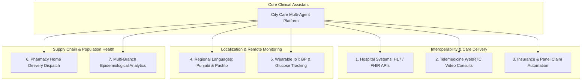
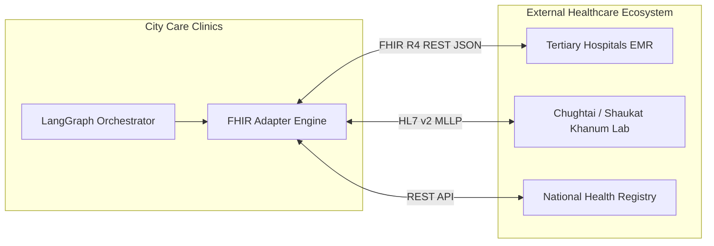
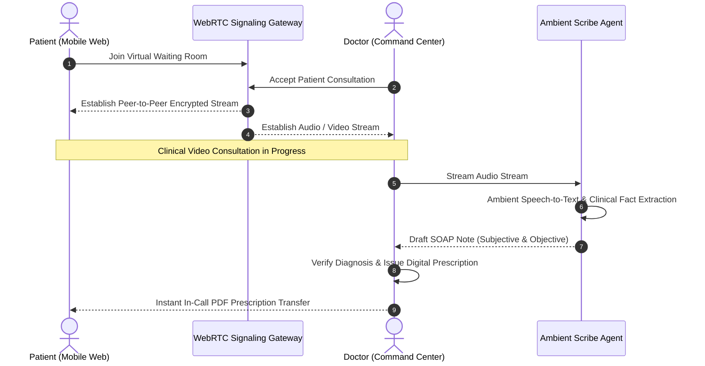
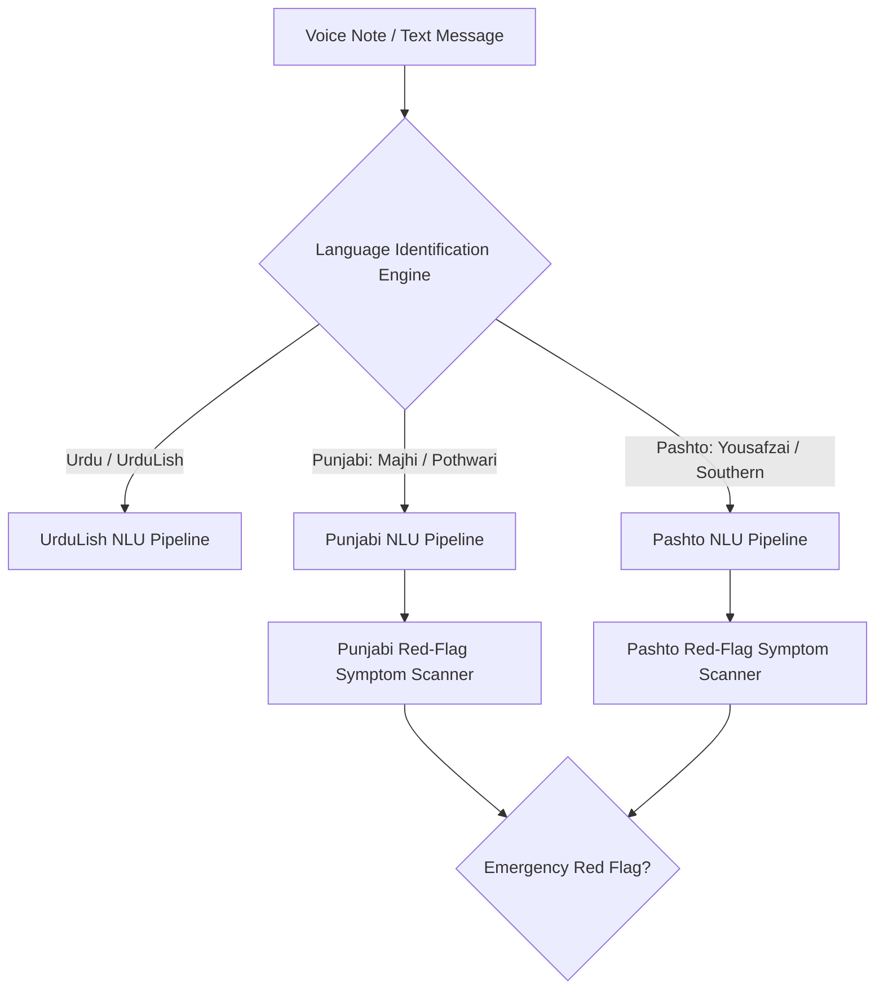
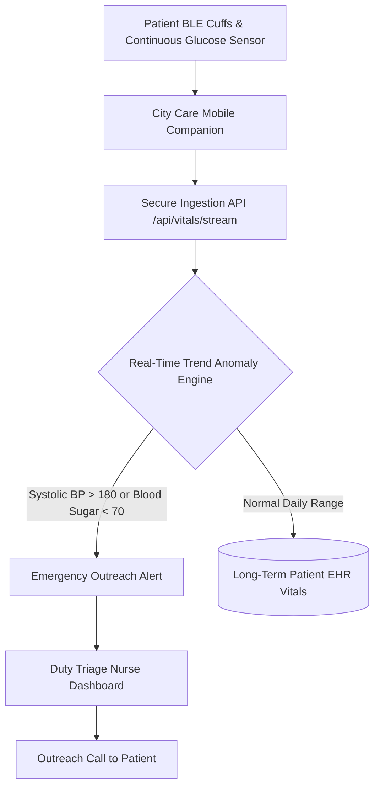
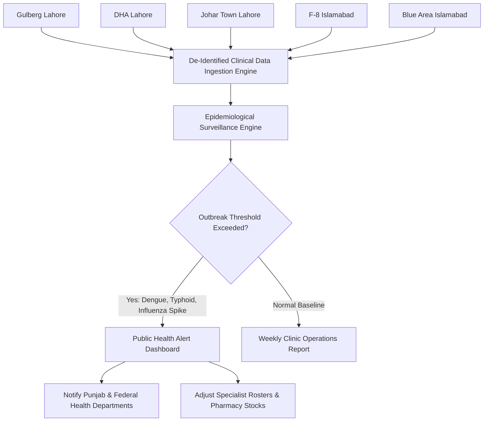

# Strategic Future Enhancements and Engineering Roadmap

This document outlines seven high-impact strategic enhancements proposed for subsequent development phases of the City Care Clinics Multi-Agent Healthcare Platform. Each proposal includes an architectural blueprint, integration standards, clinical safety controls, and an implementation roadmap.

---

## 1. Hospital Systems Integration (HL7 v2 and FHIR R4 APIs)

### Executive Need
Currently, patient records reside in an internal clinic datastore. Integrating with hospital electronic medical record (EMR) systems across Pakistan (such as Shaukat Khanum Memorial Cancer Hospital, Chughtai Lab, Aga Khan University Hospital, and tertiary government teaching hospitals) enables seamless clinical handoffs and consolidated patient histories.

### Technical Architecture
The integration implements Fast Healthcare Interoperability Resources (FHIR Release 4) REST APIs alongside an MLLP (Minimal Lower Layer Protocol) adapter for legacy HL7 v2.x systems.

### Supported FHIR Resources
* **Patient**: Demographics, CNIC national identifier, phone, family relationships.
* **Encounter**: Visit history, attending physician, clinic branch, service class.
* **Observation**: Vitals (BP, Pulse, Temperature), Laboratory findings (CBC, LFT, Lipid, HbA1c).
* **MedicationRequest**: Official prescriptions, dosages, timing, PMDC license reference.
* **Condition**: Active diagnoses, chronic health conditions mapped to ICD-10-CM.
* **AllergyIntolerance**: Verified medicinal allergies and environmental sensitivities.
* **DiagnosticReport**: Radiology summaries, ultrasound reports, pathology dossiers.

### Clinical Safety and Compliance
* Bidirectional synchronization employs TLS 1.3 encryption and OAuth2 bearer authentication.
* Strict Patient Identity Reconciliation algorithm uses CNIC, MRN, and Phone Number matching to prevent accidental patient record merging.

---

## 2. Telemedicine WebRTC Video Consultations

### Executive Need
Many patients across Lahore and Islamabad experience mobility barriers, travel delays, or require quick post-consultation check-ins. A native telemedicine suite extends clinical consultations directly to patients' homes.

### Technical Architecture
* **Signaling and Transport**: WebRTC peer-to-peer data and media streams orchestrated via a central signaling gateway.
* **Real-Time Speech-to-Text**: Low-latency audio streaming to speech models capturing UrduLish, English, and Punjabi.
* **In-Consultation Assistant Overlay**: Real-time drafting of pre-visit SOAP notes in the doctor interface as the patient speaks.

### Low-Bandwidth Optimizations
* Dynamic bitrate scaling to maintain intelligible audio during 3G mobile data dips.
* Fallback to encrypted VoIP voice call if video stream packet loss exceeds 20 percent.

---

## 3. Insurance and Panel Claim Handling Automation

### Executive Need
Private and corporate healthcare panels (State Life Insurance, Jubilee Life, Askari Life, Adamjee Insurance, EFU Life) and the government Sehat Sahulat National Health Card require lengthy manual paperwork, slowing patient checkout and causing claim rejections.

### System Capabilities
1. **Automated Eligibility Verification**: Real-time API query validating coverage limits, policy active status, and dependent relationships upon patient arrival.
2. **ICD-10 Clinical Coding Suggestions**: Maps doctor encounter notes to standard ICD-10 diagnostic codes and CPT procedure codes.
3. **Automated Claim Packet Assembly**: Compiles consultation notes, digital doctor signatures, lab investigation bills, and prescription receipts into an electronic claim packet.
4. **Pre-Authorization Workflow**: Detects high-cost diagnostic procedures (such as MRI, CT scans, specialist cardiology testing) and generates pre-approval requests instantly.

---

## 4. Regional Language Support: Punjabi and Pashto

### Executive Need
While UrduLish and English cover a broad urban demographic, millions of residents in Lahore, Rawalpindi, Islamabad, and surrounding areas speak Punjabi and Pashto as their primary languages. Full regional language inclusion improves clinical accuracy and patient trust.

### Localization Specifications

#### Punjabi Pipeline
* **Script Support**: Shahmukhi (Perso-Arabic script) and Roman Punjabi.
* **Dialect Awareness**: Majhi (Lahore, Gujranwala), Pothwari (Islamabad, Rawalpindi), and Saraiki expressions.
* **Emergency Red-Flag Keywords**:
  * *"Kaleje vich shadeed peed"* (Crushing chest pain / Epigastric distress)
  * *"Saah ruk reya hai"* (Severe acute breathlessness)
  * *"Chhati te bhaari bojh"* (Retrosternal pressure / Myocardial infarction)

#### Pashto Pipeline
* **Script Support**: Pashto Arabic script and Roman Pashto.
* **Dialect Awareness**: Northern Yousafzai dialect and Southern Kandahari/Quetta variations.
* **Emergency Red-Flag Keywords**:
  * *"Peh seene ke saqt dard"* (Severe chest pain)
  * *"Saah bandegi"* (Respiratory distress)
  * *"Sar ghashtalai"* (Acute neurological dizziness / syncope)

---

## 5. Wearable Data Monitoring (Continuous Blood Pressure and Glucose)

### Executive Need
Management of chronic conditions (Hypertension, Type 2 Diabetes, Ischemic Heart Disease) requires continuous longitudinal data rather than sporadic clinic visit measurements.

### System Integration
* **Supported Protocols**: Bluetooth Low Energy (BLE) Health Device Profile, Apple HealthKit API, Google Health Connect API.
* **Target Hardware**:
  * Blood Pressure: Omron Bluetooth Evolv / Series 10 monitors.
  * Blood Glucose: Abbott FreeStyle Libre Continuous Glucose Monitors (CGM), Accu-Chek Instant Bluetooth glucometers.
  * Pulse Oximetry: Contec and Beurer BLE pulse oximeters.

### Clinical Alarm Rules
* **Hypoglycemia Emergency**: Blood Glucose < 70 mg/dL triggers an instant notification with hypoglycemia self-care instructions (15 grams of fast-acting carbohydrates) and alerts clinic staff.
* **Hypertensive Urgency**: Systolic BP > 180 mmHg or Diastolic BP > 110 mmHg on two consecutive readings prompts a call from the triage desk.

---

## 6. Pharmacy Home Delivery Integration

### Executive Need
After online or in-person consultations, patients often face delays in acquiring prescribed medications. Linking prescriptions directly to licensed pharmacies enables home delivery.

### Operational Workflow
1. **Digital Prescription Release**: Upon doctor approval, the signed prescription transmits to accredited pharmacy partners (Servaid, Fazal Din Pharma Plus, D.Watson, Clinix).
2. **Cold-Chain Assurance**: Temperature-controlled packaging verification for biologicals and insulins (maintained between 2 and 8 degrees Celsius).
3. **Dispatch Tracking**: Patients receive a live delivery tracking URL via SMS and WhatsApp.
4. **Payment Options**: Flexible checkout supporting Cash on Delivery (COD), JazzCash, EasyPaisa, 1Link Raast, and debit/credit cards.

---

## 7. Multi-Branch Epidemiological Disease Trend Analytics

### Executive Need
With five clinics across Lahore and Islamabad, City Care Clinics possesses real-time visibility into emerging public health patterns. Aggregating complaints, diagnoses, and lab results enables early detection of infectious outbreaks.

### Surveillance Target Profiles
* **Dengue Outbreak Tracking**: Monitors sudden spikes in thrombocytopenia (< 100,000 /mcL) and acute febrile illness across Lahore branches during monsoon months (August to November).
* **Typhoid Fever Clustering**: Identifies regional surges in blood-culture-positive Salmonella enterica to alert municipal water authorities.
* **Influenza and Respiratory Syncytial Virus (RSV)**: Tracks pediatric respiratory visits across Islamabad branches during winter months.
* **Operational Benefit**: Dynamic allocation of doctors and antibiotic inventory to affected branches before local stock shortages occur.

---

## 8. Strategic Implementation Roadmap

| Enhancement Project | Target Phase | Estimated Duration | Primary Technical Dependencies |
| :--- | :--- | :--- | :--- |
| **HL7 / FHIR R4 Integration** | Phase 1 | 8 Weeks | HAPI FHIR client, Hospital EMR API gateways |
| **Telemedicine WebRTC Video** | Phase 1 | 6 Weeks | WebRTC signaling server, STUN/TURN infrastructure |
| **Pharmacy Home Delivery** | Phase 2 | 6 Weeks | Partner pharmacy inventory APIs, Rider dispatch webhook |
| **Punjabi and Pashto Support** | Phase 2 | 8 Weeks | Speech models, Dialect red-flag dictionaries |
| **Insurance and Panel Claims** | Phase 3 | 10 Weeks | Insurance clearinghouse APIs, ICD-10 coders |
| **Wearable IoT Monitoring** | Phase 3 | 8 Weeks | BLE SDKs, Apple HealthKit and Google Health Connect |
| **Epidemiological Analytics** | Phase 4 | 6 Weeks | Time-series clustering, Geographic GIS mapping |
